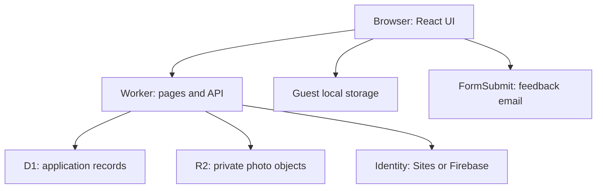

# Architecture and technical components

## System boundaries

This is a server-backed React application, not a collection of static HTML pages. Vinext provides a Next-compatible route layer and Vite builds the browser and Cloudflare Worker code. The application uses the Next APIs through this build; do not assume `next start` is its supported deployment command.

The diagram shows logical boundaries. Production currently uses Sites identity; Firebase is a separate prepared build mode. Published static assets come from the deployed `public/` content; uploads are not stored there.

## Frontend

`app/[[...path]]/page.tsx` passes the requested route to `app/mossy-app.tsx`. The main client component owns navigation, catalogue filters, dialogs, project workflows and local persistence. Extracted components cover `hero-cover`, `community-gallery`, `feedback-form`, `email-account`, `season-friend` and `butterfly-accents`.

`app/globals.css` combines custom styles with Tailwind utilities. It includes responsive/print rules, colour tokens, larger-text support and reduced-motion behaviour. `app/hero-cover.tsx` builds its slideshow from every nonarchived activity, advances every 4,000 ms, skips advances while the document is hidden and disables automatic motion for reduced-motion preferences.

## Content and media

- `content/activities.json` is the catalogue and guide source of truth. Stable IDs connect projects, diagrams, examples and tutorials.
- `content/videos.json` records durations, chapter starts and media revision hashes; `short-video-captions.json` holds the condensed captions.
- `content/narration.json` stores per-step/age recording metadata and exact text. `lib/step-narration.ts` permits a recording only when its text matches current instructions; otherwise the UI uses device speech.
- `content/privacy.json` supplies the policy in the page and account dialog.
- `public/assets/` contains ready-to-serve media; `assets/source/` contains editable generated originals. Media generation is an offline authoring step, not a visitor request.
- Tutorials are loaded as browser Blobs to support seeking through the current asset proxy. Cleanup aborts outstanding loads and revokes prior URLs.

## Backend and identity

The route handlers in `app/api/` use `lib/server-data.ts` for database access, identities, same-origin checks and bounded JSON input. The `DB` and `BUCKET` bindings come from `cloudflare:workers`.

In Sites mode, `app/chatgpt-auth.ts` reads identity provided by the trusted hosting boundary. It must not be placed on an arbitrary public server that accepts spoofed identity headers. The independent build sets `__MOSSY_STANDALONE__` and uses `lib/firebase-auth.ts` instead. Missing independent configuration disables registration; it does not trust Sites headers as a fallback.

The independent implementation uses Firebase REST for signup, sign-in, verification, resets, token refresh, lookup and deletion. Verified identity is required for application ownership. Sessions use Secure, HttpOnly, host-only SameSite cookies. Provider-dependent behaviour remains unverified in production.

## Persistence

D1 stores account and project data plus image metadata, while private R2 storage holds image bytes. Drizzle describes the schema; three ordered SQL migrations establish it. Project updates use revision numbers so stale updates receive HTTP 409 instead of silently overwriting newer progress.

Guest local storage is a separate persistence system. Transfer into an account is an explicit user choice. A progress JSON backup includes projects and favourites, not photo files. There is no automatic migration between origins or identity providers.

## Private photos and public creations

A private project photo and an activity-gallery creation are distinct records. A private photo route always checks the account owner. Public creations can be read without an account only while their state is `public`. Owners can withdraw or delete them. A valid report from another adult account changes the state to `hidden`; owners cannot undo that through sharing controls.

The browser converts acceptable files to a JPEG with a maximum 2048-pixel edge, dropping metadata during re-encoding. Server code checks the resulting JPEG structure, dimensions, metadata and limits. This is not automated semantic moderation or proof that a photo contains only a craft. See [SECURITY.md](../SECURITY.md).

## Feedback flow

1. The browser sends category, message, optional reply email and bounded page context to `/api/feedback`.
2. The route checks origin, input size, honeypot and a D1-backed rate limit; it returns whether delivery should proceed.
3. The browser then calls FormSubmit's AJAX endpoint with `credentials: omit`.
4. The page shows a result without navigation. A provider response is not proof of inbox receipt.

Because the external endpoint is callable outside this app, the app's rate limit does not establish provider-wide abuse protection. Activation and monitored inbox delivery are outstanding operational checks.

## Platform and portability

The original entrypoint `worker/index.ts` also preserves Sites connector scaffolding. The nature-craft product does not currently require a connected third-party app workflow. `worker/standalone.ts` omits that wrapper. Both still target Workers, D1 and R2.

Moving to generic shared hosting, Replit or a Node server requires runtime, identity and storage adaptations. GitHub Pages cannot run these API routes. See [DEPLOYMENT.md](DEPLOYMENT.md) for the boundary between storing code and hosting the app.
